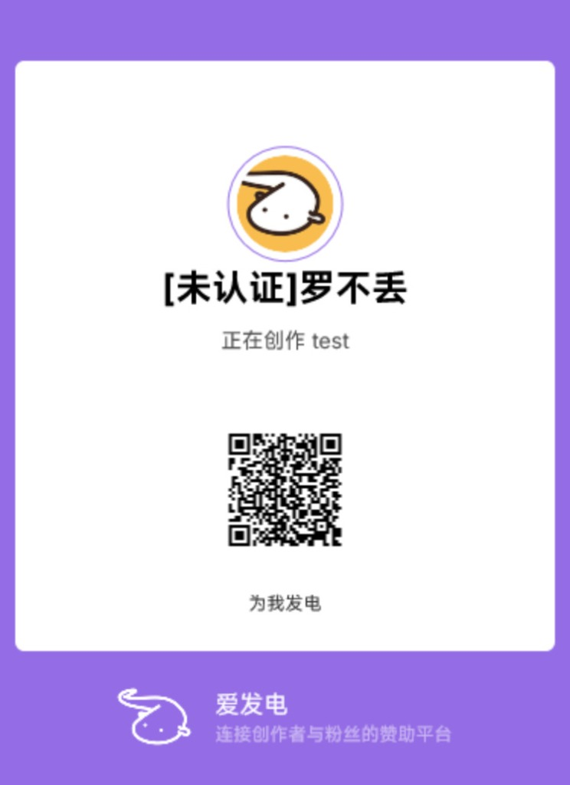

# OriginOS .itz Theme Studio

一个轻量、开源、开箱即用的 **vivo / iQOO（OriginOS 6 / 7）`.itz` 主题可视化制作、真机模拟预览与一键打包工作台**。

基于 OriginOS 7（Android 17）实机框架逆向验证，打通了**桌面图标、设置页图标（含散热风扇）、控制中心与音量条、卸载底部弹窗、全系统角色头像开关按钮、短信气泡与防变形卡片、世界时钟、锁屏原生组件、以及超级卡包（付款卡 / 镜头套件）AAPT2 混淆名映射**等完整系统美化链路。

---

## 核心特性

### 1. OriginOS 7 实机验证的全系统美化支持
- **超级卡包 (`com.vivo.card` / SuperCard) 自动兼容 OriginOS 7 AAPT2 混淆名**
  - 内置从 OriginOS 7 `SuperCard.apk` 提取的 [`supercard_obf_map.json`](supercard_obf_map.json)（49 组 / 141 枚资源），上传任意付款卡或镜头套件图片，自动按原始分辨率（`576×932`、`864×1398`、`1152×1864` 及缩略图）同步写入明文名与混淆名（如 `CA.webp / t7.webp / wq.webp`、`2W.webp / lm.webp / eM.webp`）。
- **卸载底部弹窗 (`vivo/vigour_dialog_full_light.9.png`)**
  - 支持磨砂纯色一键生成或自定义插画替换，采用 **OriginOS 安全 1px 源点九图（0 二进制 `npTc`）**，杜绝手写 `npTc` 导致的全局主题失效。
- **全系统设置 / 卡包头像开关按钮 (`VMoveBoolButton`)**
  - 一键上传角色头像生成开关开启/关闭态轨道（`vivo/vigour_bool_btn_bg_on_light.png` / `off_light.png` / `hand_normal_light.9.png`），并自动将默认竖杠/圆圈置透，避免遮挡头像。
- **控制中心 & 音量面板 (`com.vivo.systemuiplugin`)**
  - 支持一键生成**透明底防纯色球字形**（Wi-Fi / 移动数据 / 蓝牙 / 音量图标，规避 Android `SRC_IN` 染成实心球问题），同时服务端自动识别 `RIFF....WEBP` 动图 WebP 文件头以支持全彩 `AnimatedImageDrawable` 图标预览。
  - 拾色器可视化修改控制中心主色与 OriginOS 7 音量条完整配色（自动写入 `<bool name="new_style">true</bool>`、`vigour_color_track_gradient_startcolor` 及展开面板 4 条轨道底色，真机实测生效）。
- **短信气泡与防变形智能卡片 (`com.android.mms`)**
  - 一键生成左右聊天气泡与防拉伸变形的 `sms_card_view_bg.9.png` 智能通知卡片，也支持直接上传自定义插画气泡。
- **锁屏原生组件 (`com.android.systemui` + `com.vivo.systemuiplugin`)**
  - 一键生成锁屏密码按键磨砂圆底、星芒密码输入点、锁屏底部快捷方式圆底、充电闪电指示图标与底部上滑解锁提示符。
- **桌面图标工坊 & 未绘制统一样式 (`icons/` + `launcher/`)**
  - 内置常用中文 App 包名映射与 vivo 系统包名自动映射（含 `com.android.dialer` 电话拨号别名与 OriginOS 6/7 散热风扇 `ic_cooling_fan_image.png`）。
  - 支持编辑 `icon_mask`、`icon_bg_default`、`icon_cover`、文件夹样式及 `iconsize.xml`。
- **世界时钟、设置页背景、独立字体包与铃声**
  - 世界时钟表盘与指针（`clock_plate_day_6_0.png` 等）、浅/深色设置背景一键压暗生成、独立字体 `.itz` 导出、系统铃声/锁屏音效管理。

### 2. 一键免手操打包 & ADB 真机联动
- **一键自动化「主题替换包」合并导出与直推**：
  - 点击顶部 **「📦 导出替换包」** 或 **「📲 直推替换包到手机」**，自动将当前主题全量合入 `themeicon/icons.zip` 并同步 `preview/`、`wallpaper/` 到 `T/简单白.itz`，免去在手机端用文件管理器反复手操的步骤（首次使用可在网页端选择本地基础替换底包，或将其放置于项目根目录并命名为 `base_replacement_pack.itz`）。
- **ADB 批量提取手机原版图标 (ZIP)**：无需拉取完整 APK，直接从手机提取所有已安装桌面应用的原版高清图标与 `图标索引清单.csv`。
- **缺失图标扫描与 CSV 清单导出**：实时扫描已连接手机的已装应用，一键标出当前主题未绘制的图标并支持点击补图。

---

## 快速开始

### 1. 环境准备

- Python 3.10+
- 仅需安装唯一第三方依赖 `Pillow`（Web 服务端基于 Python 标准库，零框架依赖）：

```bash
pip install -r requirements.txt
```

### 2. 启动工作台

```bash
python server.py
```

Windows 用户也可直接双击 `start.bat`。启动后会自动在浏览器打开：`http://127.0.0.1:18765/`。

---

## 项目技能

技能位于 `.agents/skills/`，按主题制作阶段选用。

| 使用场景 | Codex 技能 |
| --- | --- |
| 源主题、直用替换包、SuperCard 映射与真机验收 | [主题工程与打包](.agents/skills/originos-itz-theme/SKILL.md) |
| 桌面应用图标、包名映射、整套预览 | [桌面应用图标](.agents/skills/originos-launcher-icons/SKILL.md) |
| 短信卡片、按压态与卸载底部弹窗 | [点九图卡片与弹窗](.agents/skills/originos-theme-nine-patch/SKILL.md) |
| 设置页和超级卡包的角色头像开关 | [设置头像开关](.agents/skills/originos-settings-switches/SKILL.md) |
| Wi-Fi、移动数据、蓝牙和音量面板图标 | [控制中心与音量面板](.agents/skills/originos-system-ui-icons/SKILL.md) |

本地历史导出包可放在 `历史主题包/`。当前使用的打包输入按脚本配置放置。

主题工程技能附有[资源尺寸规范](.agents/skills/originos-itz-theme/references/asset-specs.md)、[OriginOS 7 机制记录](.agents/skills/originos-itz-theme/references/originos7-architecture.md)和[包校验脚本](.agents/skills/originos-itz-theme/scripts/verify_itz.py)。

```bash
python .agents/skills/originos-itz-theme/scripts/verify_itz.py path/to/theme.itz
python .agents/skills/originos-itz-theme/scripts/verify_itz.py path/to/replacement_pack.itz --replacement-pack
```

---

## 项目结构

```text
.
├── .agents/
│   └── skills/                  # 主题工程及组件专项技能
├── server.py                    # 本地 Web GUI 服务端（零第三方 Web 框架依赖）
├── itz_engine.py                # .itz 解析、打包、OriginOS 7 资源生成与替换包合并核心
├── apk_icon_extractor.py        # ADB 批量提取手机原版应用图标（无需完整拉取 APK）
├── supercard_obf_map.json       # OriginOS 7 SuperCard.apk AAPT2 混淆名与原尺寸映射表
├── static/
│   └── index.html               # 可视化工作台、真机实时模拟预览前端
├── start.bat                    # Windows 一键启动脚本
├── requirements.txt
└── LICENSE
```

---

## 免责声明

本项目仅用于个人学习、OriginOS 主题资源结构研究与个人设备内的合法美化，仓库内**不包含任何官方受保护文件、第三方修改工具 APK 或受版权保护的美术/字体素材**。请勿将包含未授权版权素材的主题包用于公开传播或商业盈利。

<p align="center">
  
</p>
